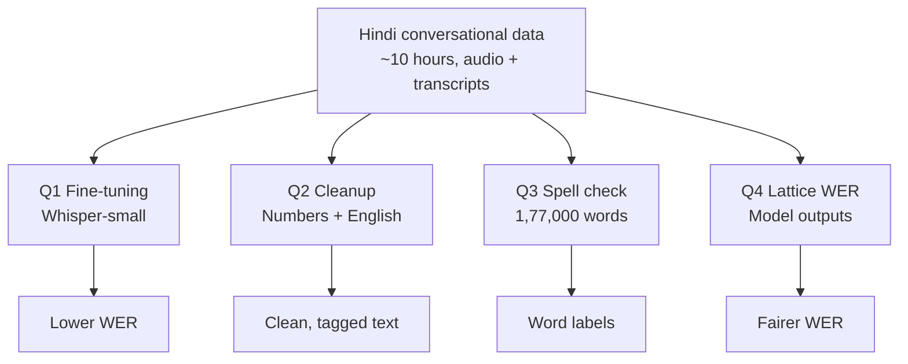
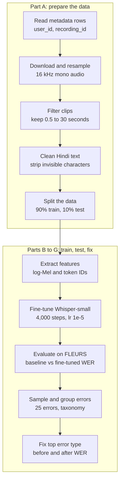
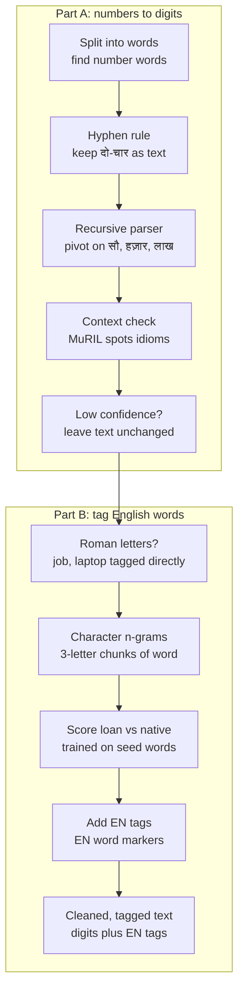
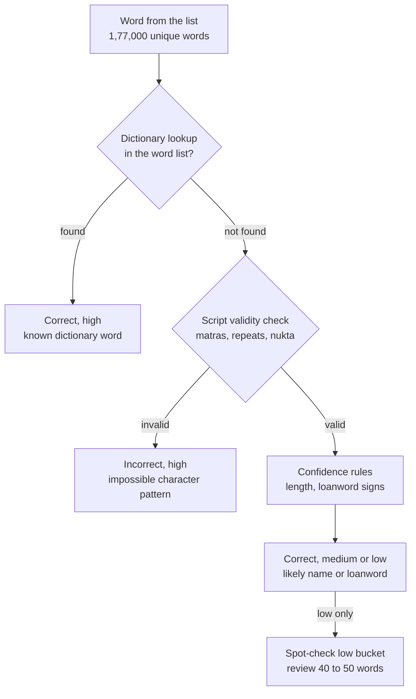
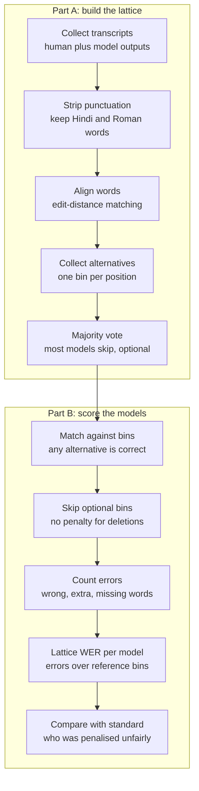

# Hindi ASR Fine-tuning & Evaluation Pipeline

**Speech AI & NLP project** | Python, HuggingFace, Whisper, MuRIL


---

## What this project is about

Speech recognition (ASR) models often struggle with conversational Hindi. This project takes about 10 hours of real Hindi conversations (audio plus human transcripts) and works through four connected problems:

1. Making Whisper better at Hindi by fine-tuning it.
2. Cleaning up messy ASR output (numbers written as words, English words mixed in).
3. Finding spelling mistakes in a list of 1,77,000 unique words.
4. Scoring ASR models more fairly when the human reference itself may be wrong.

Everything is solved in a **single Jupyter notebook**, one section per question.

> **Notebook:** [paste your notebook link here]

---

## Project overview



The four questions share one dataset but are independent of each other. None needs another's output.

---

## Q1: Fine-tuning Whisper-small on Hindi

Whisper already knows some Hindi, but it makes many mistakes on conversational speech. We train it further on our own data and compare it against the original on the FLEURS Hindi test set.



**How we proceed**

- **Resample:** Whisper only accepts 16 kHz mono audio, and a wrong sample rate quietly hurts accuracy without raising an error.
- **Filter and clean:** Very short clips (noise) and clips over 30 seconds (Whisper's window limit) are dropped. Invisible characters such as zero-width spaces are removed from the text.
- **Train:** A small learning rate (1e-5) nudges Whisper's existing knowledge rather than overwriting it. The best checkpoint is picked by WER on the held-out 10%.
- **Evaluate:** Both models run on FLEURS Hindi with identical settings.
- **Analyse:** Errors are split by severity (low, medium, high) and every third one is taken from each band, so examples are not cherry-picked. They are then grouped into categories such as schwa errors, number formats and nasal marks.

---

## Q2: Cleaning up ASR output

Raw ASR text is messy. Numbers come out as words, and English words are mixed into Hindi. Per the transcription guidelines, English words are written in Devanagari (for example, `कंप्यूटर`), and that counts as correct spelling.



**How we proceed**

- **Numbers:** Hindi numbers follow multiplier grammar, so `तीन सौ चौवन` is 3 × 100 + 54 = 354. The parser splits on the largest multiplier and recurses on each side.
- **Idioms:** `दो-चार बातें` means "a few things", not "2-4 things", so hyphenated ranges stay as text. Phrases like `दो नंबर का आदमी` need context, so MuRIL embeddings are compared against idiom and quantity examples.
- **Safe fallback:** If confidence is low, nothing is converted. A missed conversion is better than a wrong one.
- **English words:** Roman-script words are tagged directly. Devanagari loanwords are caught by character n-grams, because patterns like `ॉ` and certain consonant clusters almost never appear in native Hindi words.

---

## Q3: Spell-checking 1,77,000 words

Hindi has no single official dictionary, and valid words such as names and loanwords are often missing from any dictionary. So the check is a pipeline rather than a lookup.



**How we proceed**

- **Dictionary first:** A word found in the dictionary is marked correct with high confidence.
- **Script rules next:** A word not in the dictionary is checked against what Devanagari allows. A vowel sign at the start of a word, or a character repeated three times, can never be a real word. These are marked incorrect with high confidence.
- **Honest uncertainty:** Words that pass the script check but are not in the dictionary are probably names or loanwords. They are marked correct with medium or low confidence and sampled for manual review.

**Where it struggles:** Alternate spellings of a name (`रोहन` and `रोहान`) both look valid, so the system cannot tell which is intended. Merged words such as `सोजाओ` (should be `सो जाओ`) also pass every check because they look like valid words.

---

## Q4: Lattice-based WER

Standard WER compares a model against one fixed human reference. If the human made a mistake, correct models get penalised. A lattice replaces the single reference with a list of bins, one per word position, each holding all valid alternatives.



**Example from the data:** The human wrote `हम्म बहुत प्योर हार्ट रहता है सबका`, but most models left out `हम्म`. Under standard WER every one of them is penalised for a filler word that was probably barely audible. In the lattice, that bin becomes optional once enough models agree.

**Alignment unit:** Words. WER is a word-level metric, and the variations in the data (merges, splits, substitutions) happen at word boundaries.

---

## Results

| Model | WER on FLEURS Hindi test |
|-------|--------------------------|
| Whisper-small (pretrained) | _fill in after running_ |
| Whisper-small (fine-tuned on ~10h Hindi) | _fill in after running_ |

Q4 results (standard vs lattice WER per model) are printed by the last section of the notebook.

---

## Known limitations

- **Q4 lattice coverage:** An alternative enters a bin only if a model actually produced it. A valid variant that no model output will not be recognised.
- **Q4 model count:** The dataset has six model columns, but the assignment describes five models. The majority threshold must match the number of models actually compared.
- **Q3 names and merged words:** See the Q3 section above. Confidence tiers exist so these cases go to human review rather than being decided automatically.
- **Q2 seed data:** The idiom examples and loanword lists are small hand-picked seeds. Larger seeds built from the real data would make both more reliable.

---

## Tech stack

| Area | Tools |
|------|-------|
| Models | `openai/whisper-small`, `google/muril-base-cased` |
| Training | HuggingFace Transformers, `Seq2SeqTrainer` |
| Audio | Librosa, SoundFile |
| Evaluation | HuggingFace Evaluate, JIWER |
| Data | Pandas, NumPy |
| Benchmark | FLEURS `hi_in` test set |

---

## How to run

```bash
git clone https://github.com/Anki2004/hindi-asr-pipeline
cd hindi-asr-pipeline
pip install transformers datasets accelerate evaluate jiwer librosa soundfile torch pandas
```

Open the notebook and run it from top to bottom. Each question's section is self-contained, so you can also run just one. A GPU is recommended for Q1 (training); the other sections run on CPU.

The dataset URLs in the assignment may be outdated. Use the updated URL format given in the task instructions when downloading audio, transcriptions and metadata.

---

## Author

**Ankit** | B.Tech IT (AI/ML), MSIT Delhi
[GitHub](https://github.com/Anki2004) | [LinkedIn](https://linkedin.com/in/your-profile) | your@email.com
